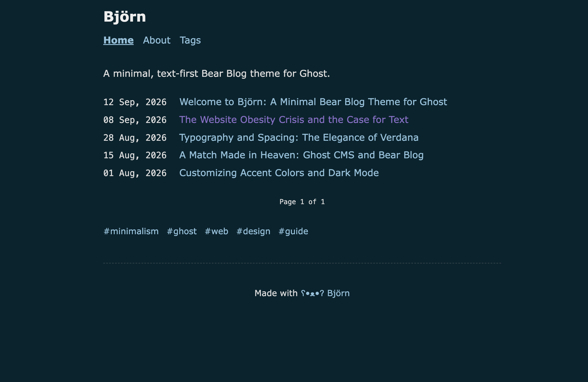

# Björn ʕ•ᴥ•ʔ

> A bare-metal, text-first [Bear Blog](https://bearblog.dev) theme for Ghost CMS. No bloat, no trackers, no client-side framework rituals.



## Vitals

| Metric | Spec |
| :--- | :--- |
| **CSS Payload** | `~5.7 kB` minified (`index.css`) |
| **Client JS** | `0 kB` (zero runtime hydration) |
| **Typography** | Verdana / monospace (zero web-font requests) |
| **Theme Engine** | System `prefers-color-scheme: dark` (`#01242e`) |
| **Layout** | `720px` max-width container, 130px fixed date column |
| **Target** | Ghost `^5.0.0` (Full Koenig card + comment support) |
| **Projects** | Tiered showcase template (`custom-projects.hbs`) |

## Quickstart

```bash
# 1. Clone & pack
git clone https://github.com/klppl/bjorn.git
cd bjorn
npm run zip

# 2. Upload bjorn.zip via Ghost Admin -> Settings -> Design -> Change theme
```

## Local Preview (Zero-dep)

Run the standalone preview server with hot mock data:

```bash
npm run preview
# Listening on http://localhost:3000
```

## License

[The Lagom License](LICENSE) — *"Not too much, not too little — just the right amount of freedom."*
